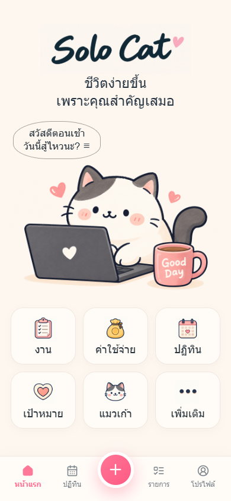
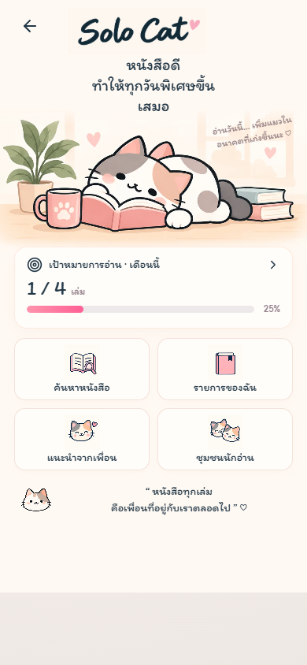
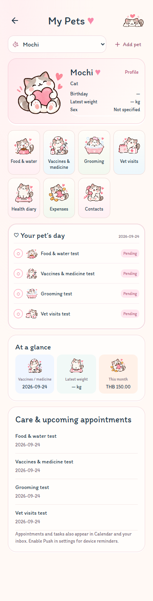

# Solo Cat 🐾

**A bilingual personal organizer that helps everyday life feel lighter.**

[Live demo](https://solocat.click/) · [English guide](https://solocat.click/about-en.html) · [คู่มือภาษาไทย](https://solocat.click/about-th.html)

Solo Cat is a mobile-first progressive web app for people who want one calm place to manage tasks, projects, money, reading goals, pet care, family information, vehicles, overtime and personal goals. The product uses an original cat-themed interface in Thai and English.



## Highlights

- Tasks, calendar entries and recurring schedules
- Weighted projects with phases, subtasks and precise progress calculation
- Income, expenses, subscriptions, debt, savings and monthly summaries
- Overtime and extra-job calculations
- Reading goals, reading logs, recommendations, reviews and quizzes
- Pet profiles, care history, expenses and important contacts
- Family, vehicle and emergency-information organizers
- Offline-first browser storage and installable PWA support
- Google sign-in and encrypted cloud backups in the production service
- Responsive Thai and English interfaces

<p align="center">
  
  
</p>

## Tech stack

- React 18 and Vite
- JavaScript and CSS
- Firebase Authentication on the deployed product
- IndexedDB for structured offline data
- Service Worker and Web App Manifest for PWA behavior
- ExcelJS for supported exports
- Lucide icons with original Solo Cat illustration assets

## Run locally

```bash
npm install
cp .env.example .env.local
npm run dev
```

The interface can run without Firebase configuration in guest mode. Add your own Firebase Web app values to `.env.local` to test Google sign-in. Never commit that file.

```bash
npm test
npm run build
npm run preview
```

## Privacy and repository scope

This public portfolio repository contains the frontend application only. Production backend code, deployment configuration, owner-only reporting, operational scripts, credentials and user data are deliberately excluded. The checked-in `.env.example` contains placeholders only.

Cloud backup and member-only community features require the private production API. Their public UI remains visible here to demonstrate the complete product flow, but a local clone does not receive production access.

## Product and design

Solo Cat was designed around short, friendly flows rather than dense dashboards. Each feature keeps the cat companion present while making totals, due dates and progress understandable on a small screen. Accessibility details include semantic controls, keyboard focus styles, responsive layouts down to 320 px and reduced reliance on color alone.

This source is shared as a portfolio project. No license for redistribution is granted.
